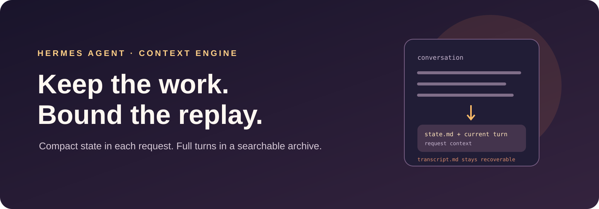
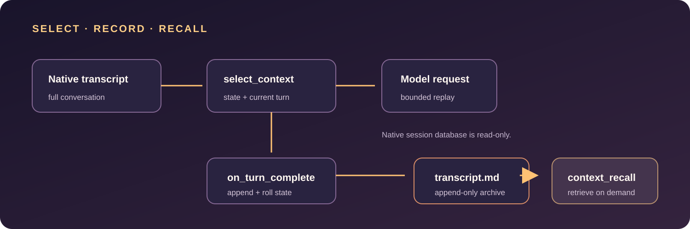
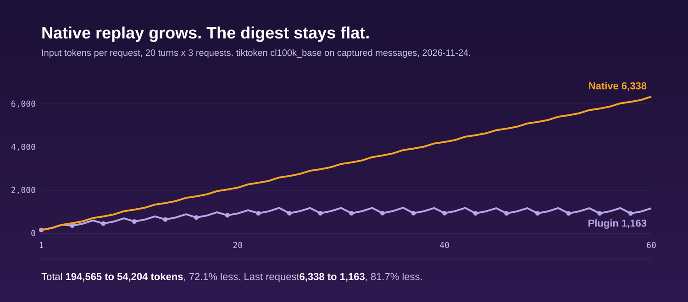

# markdown-memory-hermes



A context engine plugin for [Hermes Agent](https://github.com/NousResearch/hermes-agent) that makes long-running agent conversations cost-efficient: instead of re-sending the entire accumulated chat history on every API call, it swaps old history for a compact, file-backed working state. Works with any model Hermes can drive (OpenAI, Anthropic, Gemini, GLM, DeepSeek, local models) — the engine only reshapes the request payload; it never touches model configuration.

## How it works



Hermes natively replays the full transcript on every LLM request, so input tokens grow with chat length. This engine cuts at three seams — all deterministic text processing, no LLM summarisation:

| Seam | When | What it does |
|---|---|---|
| `select_context` | before every API request | swaps pre-turn history for `system prompt + digest + current turn` |
| `on_turn_complete` | when a turn finishes | appends the turn to `transcript.md`, rolls `state.md`, freezes a new digest |
| `context_recall` | when the model asks | greps `transcript.md`, returns matching turns — you pay only for what you retrieve |

The cut point is always *before the current turn's user message*, so every `tool_call_id` ↔ result pair — including parallel calls and multi-round turns — stays inside the request. The digest is frozen mid-turn: every retry and tool-round replays a byte-identical prefix (prompt-cache friendly). Old detail lives in two files per session — `state.md` (rolling working memory, capped at 4k chars) and `transcript.md` (append-only archive) — and never disappears: `context_recall` fetches it on demand.

Fail-open by design: a session without memory files passes through unchanged, and a crashing engine cannot break a run (every hook swallows its own exceptions).

Full mechanics, file formats, and known limits: [docs/HOW_IT_WORKS.md](docs/HOW_IT_WORKS.md)

## The evidence

Reproducible synthetic benchmark — 20 turns × 3 requests per turn, tiktoken `cl100k_base` on the captured messages, harness in `benchmarks/`:



| | Native replay | With markdown-memory |
|---|---|---|
| Total input tokens, 60 requests | 194,565 | **54,204 (−72.1%)** |
| Last request | 6,338 | **1,163 (−81.7%)** |

Native per-request size grows linearly with chat length; the plugin's stays flat (~900–1,160 tokens) once the digest exists. Re-running the harness produces byte-identical JSON.

Honest scope: tokens counted with a pinned tokenizer on captured messages, not provider-billed usage; the fixture is synthetic, so the percentage will move on real conversations; longer sessions help more (native keeps growing, the digest does not). Methodology, per-request values, and the retired 306k → 59k claim that this benchmark **replaced because it was not reproducible**: [docs/BENCHMARKS.md](docs/BENCHMARKS.md)

## Where it sits in a token-reduction stack

| Layer | Tool | What it cuts | When |
|---|---|---|---|
| Conversation history | **markdown-memory** | old *turns* | before every API request |
| Tool output | rtk | *size of tool results* | at tool execution time |
| Codebase knowledge | graphify | *file reading* | during research |

They stack: rtk and graphify shrink what *enters* the conversation; markdown-memory shrinks what *stays* in it. Details: [docs/COMPARISON.md](docs/COMPARISON.md)

## Install

```bash
# 1. Copy the plugin into your Hermes plugins directory
cp -r markdown-memory-hermes ~/.hermes/plugins/

# 2. Select it in config.yaml
context:
  engine: markdown-memory

# 3. Restart Hermes
```

Rollback: `hermes config set context.engine compressor`, restart Hermes. Memory files stay on disk as inert archives; the session database is untouched at every point.

## Migrating existing sessions

`bootstrap.py` reads the native session database (strictly read-only) and creates memory files:

```bash
python3 bootstrap.py                    # report only (dry-run default)
python3 bootstrap.py --write --session <id> ...
python3 bootstrap.py --reconcile --backfill --write --session <id>
python3 bootstrap.py --repair-state --write --session <id>
```

Dry-run default, atomic writes, never overwrites, live turns untouched; ambiguity is flagged for manual review instead of silently migrated.

## Tests

```bash
HERMES_REPO=/path/to/hermes-agent pytest tests/ -q
```

Unit tests (selection semantics, tool pairing, determinism, fail-open, migration) plus live-pipeline integration tests against a mock provider. The suite asserts byte-identical retry payloads and zero orphaned tool results on the wire. No test counts tokens — the token figures come only from the benchmark harness.

## License

MIT
