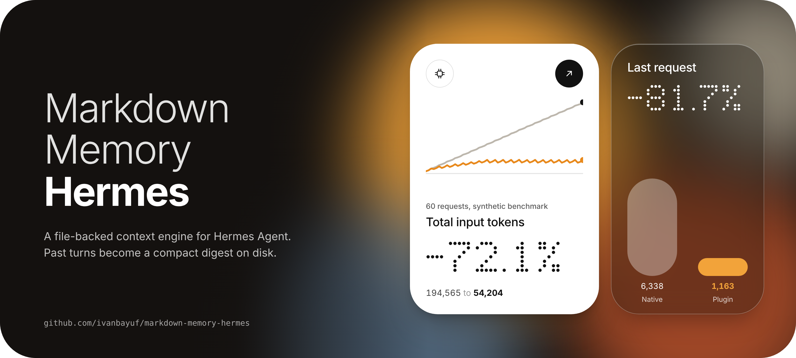
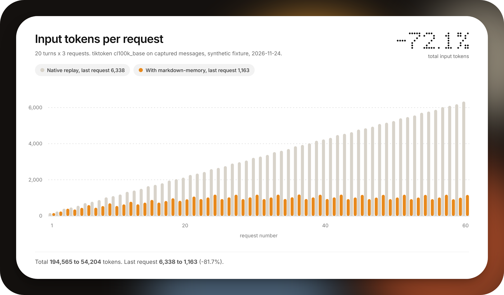

# markdown-memory-hermes



## The context

[Hermes Agent](https://github.com/NousResearch/hermes-agent) is built for long-running conversations: one session keeps working across hours, days, even weeks. But its context engine replays the **entire** accumulated chat history on every single API call — so a session that feels normal to you becomes an enormous bill.

## The problem

Input tokens grow linearly with chat length, and the growth compounds:

- Every request re-sends turns you never need again — past tool dumps, old drafts, resolved debugging.
- It gets worse on multi-tool turns: retries and tool-rounds replay the full transcript again each time.
- And the bigger the history, the more the problem repeats on every request, every turn.

In our benchmark, a 20-turn session where each turn makes 3 requests sent **194,565 input tokens natively** — and the last request alone was 6,338 tokens, all of it history that had nothing to do with what the user just asked.

## The solution

markdown-memory — a context engine plugin that swaps pre-turn history for a compact, file-backed working state. All deterministic text processing, no LLM summarisation, works with any model Hermes can drive. It cuts at three seams:


| Seam | When | What it does |
|---|---|---|
| `select_context` | before every API request | swaps older history for `system prompt + digest + previous exchange + current turn` |
| `on_turn_complete` | when a turn finishes | appends the turn to `transcript.md`, rolls `state.md`, freezes a new digest |
| `context_recall` | when the model asks | greps `transcript.md`, returns matching turns — you pay only for what you retrieve |

The cut point is always *before the message that opened the current turn* (the host's `incoming_message`, so an interrupt/redirect mid-turn doesn't move it), so every `tool_call_id` ↔ result pair — including parallel calls and multi-round turns — stays inside the request. The previous exchange (your last message and the model's final reply) is sent as plain text, so follow-ups like "do option 2" work without a recall round-trip. The digest is frozen mid-turn: every retry and tool-round replays a byte-identical prefix (prompt-cache friendly within a turn). Old detail lives in two files per session — `state.md` (rolling working memory, capped at 2,400 chars) and `transcript.md` (append-only archive) — and never disappears: `context_recall` fetches it on demand.

Fail-open by design: a session without memory files passes through unchanged, and a crashing engine cannot break a run (every hook swallows its own exceptions).

Full mechanics, file formats, and known limits: [docs/HOW_IT_WORKS.md](docs/HOW_IT_WORKS.md)

## The impact

Reproducible synthetic benchmark — 20 turns × 3 requests per turn, tiktoken `cl100k_base` on the captured messages, harness in `benchmarks/`:



| | Native replay | With markdown-memory |
|---|---|---|
| Total input tokens, 60 requests | 194,565 | **54,204 (−72.1%)** |
| Last request | 6,338 | **1,163 (−81.7%)** |

Native per-request size grows linearly with chat length; the plugin's stays flat (~900–1,160 tokens) once the digest exists. Re-running the harness produces byte-identical JSON.

> **These figures predate the 2026-11-25 engine** (they were measured with a 4,000-char state cap and no previous-exchange tail). A character-count comparison on the same fixture shape puts the current engine at ~78% saved versus ~80% for the old one: the verbatim previous exchange adds ~8% per request. Re-run `benchmarks/bench_hermes.py` to refresh them; see [docs/BENCHMARKS.md](docs/BENCHMARKS.md).

Honest scope: tokens counted with a pinned tokenizer on captured messages, not provider-billed usage; the fixture is synthetic, so the percentage will move on real conversations; longer sessions help more (native keeps growing, the digest does not). Methodology, per-request values, and the retired 306k → 59k claim that this benchmark **replaced because it was not reproducible**: [docs/BENCHMARKS.md](docs/BENCHMARKS.md)

### Where it sits in a token-reduction stack

| Layer | Tool | What it cuts | When |
|---|---|---|---|
| Conversation history | **markdown-memory** | old *turns* | before every API request |
| Tool output | rtk | *size of tool results* | at tool execution time |
| Codebase knowledge | graphify | *file reading* | during research |

They stack: rtk and graphify shrink what *enters* the conversation; markdown-memory shrinks what *stays* in it. Details: [docs/COMPARISON.md](docs/COMPARISON.md)

## Install

```bash
# 1. Copy the plugin into your Hermes plugins directory
cp -r markdown-memory-hermes ~/.hermes/plugins/

# 2. Select it in config.yaml
context:
  engine: markdown-memory

# 3. Restart Hermes
```

Rollback: `hermes config set context.engine compressor`, restart Hermes. Memory files stay on disk as inert archives; the session database is untouched at every point.

## Migrating existing sessions

`bootstrap.py` reads the native session database (strictly read-only) and creates memory files:

```bash
python3 bootstrap.py                    # report only (dry-run default)
python3 bootstrap.py --write --session <id> ...
python3 bootstrap.py --reconcile --backfill --write --session <id>
python3 bootstrap.py --repair-state --write --session <id>
```

Dry-run default, atomic writes, never overwrites, live turns untouched; ambiguity is flagged for manual review instead of silently migrated.

## Tests

```bash
HERMES_REPO=/path/to/hermes-agent pytest tests/ -q
```

Tests always load the plugin source in this checkout (never an installed copy). Unit tests run anywhere; the live-pipeline integration tests (mock provider) need a Hermes checkout via `HERMES_REPO` and are skipped without one. After changing the plugin, copy it to `~/.hermes/plugins/markdown-memory/` again — the installed copy does not update itself. The suite asserts byte-identical retry payloads and zero orphaned tool results on the wire. No test counts tokens — the token figures come only from the benchmark harness.

## License

MIT
