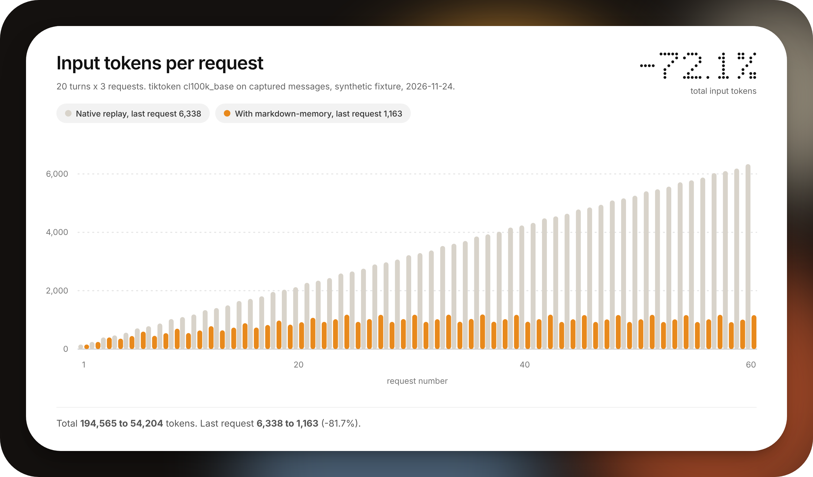

# Benchmark evidence and reproduction

## Measured 2026-11-24 (reproducible, synthetic fixture)



Harness: `benchmarks/bench_hermes.py` (fixture seed `20261124`,
`benchmarks/results/hermes-2026-11-24.json` — per-request values included).
Counting: **tiktoken `cl100k_base`** applied to the exact captured `messages`
lists, identically for both arms. Run it yourself:

```sh
python3 -m venv .venv && .venv/bin/pip install -r benchmarks/requirements.txt
.venv/bin/python benchmarks/bench_hermes.py
```

**Scenario:** 20 turns × 3 requests per turn (initial message + 2 tool
rounds), deterministic fixture. Per turn: user ~300 chars, assistant ~600
chars, 1 tool call + result ~1,100 chars — about 2,000 chars / ~500 tokens
of new content per turn. System prompt 792 chars, fixed.

| | Native replay | With markdown-memory |
|---|---|---|
| Total input tokens, 60 requests | 194,565 | **54,204 (−72.1%)** |
| Mean per request | 3,242.8 | **903.4**¹ |
| Median per request | 3,253.5 | 937.5 |
| Last request | 6,338 | **1,163 (−81.7%)** |
| Total chars sent | 1,325,625 | 313,449 |

¹ Mean/median are post-fix values. The pre-fix run (before the `state.md`
heading fix, 2026-11-24) measured 45,057 total / 751.0 mean: the fix keeps
all `### Turn N` headings in `state.md`, so the digest is slightly larger —
correctness costs ~9k tokens over 60 requests on this fixture, and the
headings are what make the digest (and the 8-turn rolling cap) work at all.

**What else the run established:**

- The digest is **frozen within a turn**: 19 of 20 turns had exactly one
  digest hash across their 3 requests (turn 1 has no digest yet — its first
  request passes through unchanged, 156 tokens in both arms).
- `state.md` grows 907 chars (turn 1) → 3,962 chars (turn 20), max 3,964 —
  under the 4,000-char cap.
- Native per-request size grows linearly with chat length (156 → 6,338
  tokens); plugin per-request size stays flat (~900–1,160 tokens) once the
  digest exists. The plugin line's sawtooth is the current turn growing
  within each turn (round 1 → round 3), then resetting at the next turn.
- Re-running the harness produces byte-identical JSON (verified 2026-11-24).

**What this does NOT establish:** provider-billed tokens, prompt-cache hit
rates, or cost in dollars — counting is on captured messages with a pinned
tokenizer, not a provider `usage` report. `context_recall` cost is excluded
(zero when unused; on-demand when used). The fixture is synthetic: real
conversations have different turn sizes, tool-result sizes, and system
prompts, so the percentage will move. Longer sessions help the plugin more
(native keeps growing; the digest does not).

## The README's earlier 306k → 59k claim (not reproduced)

The README previously reported a real multi-turn, multi-round-tool
conversation (20 turns × 3 API calls): **~81% fewer input tokens (306k →
59k estimated)**, last request ~10.2k → ~1.4k tokens. That claim is
**not reproduced by the measurement above** and is kept here only as a prior
author-reported estimate:

- No fixture, raw request payloads, tokenizer report, or per-request values
  for that conversation exist in this repo, so it cannot be re-run.
- The arithmetic is internally consistent (59/306 = 80.7%; 1.4/10.2 = 86%)
  and the shape matches the measured scenario (native grows linearly, plugin
  stays flat) — plausible, but plausibility is not evidence.
- Do not cite 306k → 59k as a measured result. The reproducible numbers are
  the 194,565 → 54,204 ones above.

## What tests establish (and what they don't)

The unit + bootstrap suite (`pytest tests/test_markdown_memory.py
tests/test_bootstrap.py` — 57 passed, 2026-11-24; the one remaining failure
is `TestContract.test_engine_is_context_engine_subclass`, which needs the real
Hermes `agent` module from a Hermes checkout) covers selection semantics,
parallel/multi-round tool pairing, byte-identical retry prefixes, recording,
state caps, resume, recall, bootstrap safety, fail-open, and the two
2026-11-24 regressions (state headings, reset passthrough). **No test counts
tokens** — the token figures come only from the benchmark harness above.

The integration suite (`tests/test_integration_agent.py`) runs the real Hermes
agent loop against a mock provider and needs a Hermes checkout:

```sh
HERMES_REPO=/path/to/hermes-agent pytest tests/ -q
```

It was not run in this update (no Hermes checkout on the benchmark machine).

## Reproduce the original claim (for a future run)

To turn the 306k → 59k estimate into a measurement, a run must: pin the
Hermes Agent and plugin commits, provider, model, tokenizer, and sampling
settings; use one fixed 20-turn transcript with identical tool-call/result
payloads in both conditions; capture outbound messages before provider
serialisation; count with the pinned tokenizer and report provider input and
cached-input usage separately; repeat on fresh sessions; and publish the
fixture, runner, environment, raw counts, and checksum. Do not infer provider
cost from character count alone.
