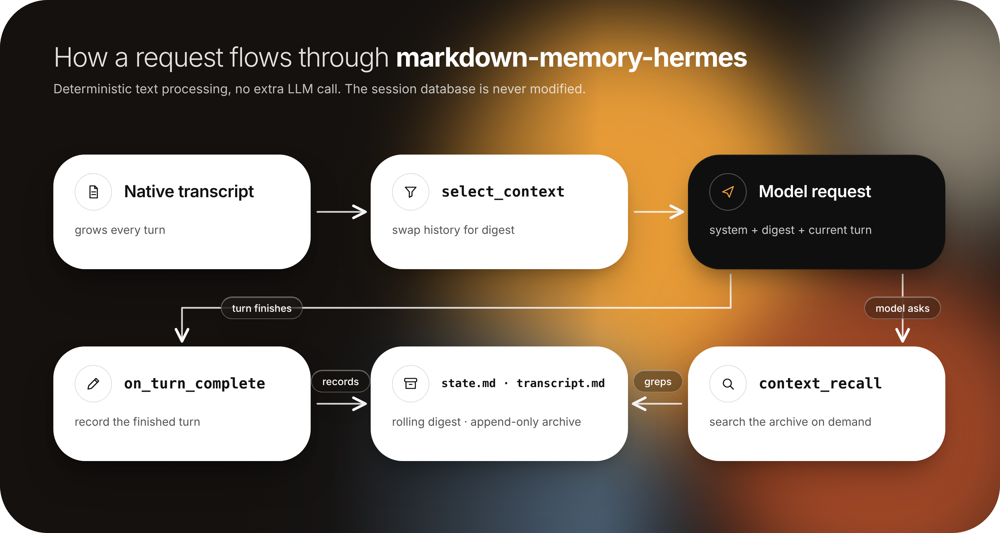

# How markdown-memory-hermes works

A Hermes Agent context-engine plugin. Hermes natively replays the full
conversation transcript on every LLM request, so input tokens grow with chat
length. This engine replaces older history with a short, frozen digest plus
the previous exchange, keeps the current turn verbatim, and persists what it
removed to two files per session. No LLM summarisation anywhere — every step below is
deterministic text processing.

## The three seams

| Seam | When it runs | What it does |
|---|---|---|
| `select_context` | Before every API request | Swaps older history for `system prompt + digest + previous exchange + current turn` |
| `on_turn_complete` | When a turn finishes | Appends the turn to `transcript.md`, rolls `state.md`, freezes a new digest |
| `context_recall` (tool) | When the model asks | Searches `transcript.md` and returns matching turns |

## Request lifecycle

1. **Hermes assembles a request** — system prompt + full transcript replay +
   the new user message.
2. **`select_context` cuts it** — the cut point is always *before the message
   that opened the current turn*. The engine anchors on the host's
   `incoming_message`, so a user-role correction the host appends mid-turn
   (interrupt / redirect) does not move the cut and drop the turn's earlier
   tool work. Without `incoming_message` it falls back to the last user
   message. The replacement is `[leading system messages] + [one user message
   carrying the digest] + [previous exchange] + [everything from the turn's
   opening message onward]`.
   - **Previous exchange**: the last user message and the final assistant
     reply before the current turn, as plain-text messages (no tool rows, so
     no pairing obligations; user text ≤2,000 chars, reply ≤6,000 chars,
     images dropped). This lets the model resolve "do option 2" without a
     recall round-trip. Its `### Turn` section is left out of the digest so
     it is not sent twice. Disable with `keep_last_exchange=False`.
   - The digest is injected as a `user` message, so the wire has consecutive
     `user` messages; that is intentional and covered by tests.
3. **The digest is frozen mid-turn** — `on_turn_complete` is the only place
   the digest changes, so every retry and tool-round inside a turn replays a
   byte-identical prompt prefix (prompt-cache friendly). Verified by the
   benchmark harness: 19 of 20 turns in the measured scenario had exactly one
   digest hash across their 3 requests (turn 1 has no digest yet — its first
   request passes through unchanged).
4. **The turn finishes** — `on_turn_complete` extracts the turn
   deterministically (user ask, tool calls with ids and results, final
   response), appends it to `transcript.md`, and rewrites `state.md`.
5. **The model needs older detail** — it calls `context_recall` with a query;
   matching turn sections come back as tool results. You pay only for what
   you retrieve, and only when you retrieve it.

## The two files (per session, under `$HERMES_HOME/context-memory/<session>/`)

- **`state.md` — rolling working state.** Header (`Session`, `Updated`),
  `## Goal` (the first turn's user text after a session start or reset,
  clipped to 300 chars — not a summary), then `## Recent turns`: up to
  **8 turns**, each `### Turn N` with `User:` (≤200 chars), `Tools used:`
  (≤10 names), `Assistant:` (≤300 chars). Every field is collapsed to one
  line, so markdown inside a message cannot inject headings. Hard cap
  **2,400 chars** — oldest turns drop first, but at least one turn is always
  kept. Written atomically (`.md.tmp` + `os.replace`).
- Gateway routing metadata (`Gateway message origin (JSON data, …)` blocks)
  is stripped from user text before it reaches the goal, digest or archive.
- **`transcript.md` — append-only archive.** One `## Turn N — timestamp —
  status: ok|failed|interrupted` section per turn, with `USER:` /
  `ASSISTANT:` / `TOOL_CALL <name> args:` / `TOOL_RESULT[<id> (<name>)]`
  lines, each clipped to 2,000 chars. Continuation lines that look like
  archive structure (`#…`, `USER: `, `TOOL_RESULT[` …) are escaped with a
  leading `\`. Appends take an exclusive `flock` (POSIX), and if another
  process changed the file since this engine's last write, the turn number is
  re-derived from the file, so two writers never reuse a number. **System
  messages are not archived** — the archive is a record of turns, not a
  complete transcript.

## Tool-call continuity guarantees

- The cut point is always before the current turn's user message, so every
  `tool_call_id` ↔ tool-result pair — including **parallel tool calls** and
  **multi-round turns** — stays inside the request. Provider pairing rules are
  never violated (asserted by tests on synthetic and real wire payloads).
- If the model needs pre-turn history, `context_recall` fetches it on demand
  instead of the request carrying it.
- `context_recall` takes `query` (required) and `limit` (default 5, clamped
  1–20). Sections are ranked by how many distinct query terms they contain,
  then by term frequency (capped per term, so one long turn can't win on a
  repeated word), then newest first. An empty query returns the last N turns,
  newest first. Output is capped at ~1,500 chars per turn and ~4,000 total.
  Errors return a generic message (no paths or exception text).

## Fail-open by design

- Every hook swallows its own exceptions: a broken session directory degrades
  recording to a no-op while selection keeps working.
- A session without memory files (or with an empty digest) **never** gets its
  history replaced — `select_context` passes the request through unchanged, so
  Hermes' native context behaviour applies. There is deliberately no
  placeholder digest: an earlier version substituted one after a session
  reset, discarding real history (fixed 2026-11-24, with regression tests).
- The host also wraps `select_context` in its own fail-open guard; a crashing
  engine cannot break a run. (Host-side property, not verifiable from this
  repo — no Hermes code lives here.)
- Compaction is disabled by design: `should_compress()` is always `False`
  and `compress()` returns messages unchanged. The engine owns the context
  policy; host compaction must never rewrite the persisted transcript.

## Migrating existing sessions

`bootstrap.py` reads the native session database (strictly read-only,
`mode=ro`) and creates memory files for existing sessions. Dry-run is the
default; `--write` creates files atomically and refuses to overwrite either
file. `--reconcile` / `--backfill` append turns that finished after a
snapshot (idempotent, append-only); `--repair-state` rebuilds `state.md`
from closed turns, backing the old file up first. Ambiguity (orphaned tool
results, missing user messages, first row not user) is flagged for manual
review instead of silently migrated. See the README for the commands.

## Limits — read these before relying on the engine

- **"Constant-size" describes the digest, not the request.** The digest is
  capped, but the current turn is sent verbatim and unbounded — a turn with
  huge tool results still makes a large request.
- **The first request of a session is never compressed** (no digest yet), and
  a session with no digest at all passes through natively.
- **Older detail is recoverable only if it was archived and `context_recall`
  finds it.** The archive drops system messages, and recall is substring
  scoring, not semantic search.
- **Locking covers the archive only.** Archive appends are locked and turn
  numbers stay unique, but two processes still each rewrite `state.md` from
  their own view (last writer wins).
- **Session-id sanitisation can collide** (`sess/abc` and `sess_abc` map to
  the same directory; ids truncate at 120 chars). Two sessions sharing a
  directory would share/corrupt one `state.md`/`transcript.md`.
- **`/new` / `/reset`** drops the in-memory digest (requests pass through
  natively until the next turn is recorded). The next recorded turn starts a
  fresh `state.md` (the old one is kept as `state.md.pre-reset-<stamp>.bak`)
  and writes a `## Session reset` marker into the archive. Turn numbers keep
  counting, so they stay unique, and pre-reset turns remain recallable.
- **The previous exchange makes requests ~8% larger** than digest-only
  selection on the benchmark fixture shape (character count). It is the cost
  of the model seeing its own last reply in full.
- **`bootstrap.py --reconcile` drops tool-call declarations** for assistant
  rows that carry only `tool_calls` and no text (backfill keeps them).
- **`repair-state` renumbers turns from 1**, which can disagree with the
  archive's existing numbering.

## Porting to other agent frameworks

The *pattern* — pre-send context replacement backed by markdown files — is
host-agnostic and model-agnostic. This implementation is Hermes-specific
because it binds to three Hermes facilities: the `ContextEngine.select_context()`
hook, the session database (for migration), and plugin discovery under
`~/.hermes/plugins/`. Porting means re-implementing the same contract against
the new host's interception point: replace accumulated messages with
`digest + current turn`, record completed turns on a turn-finalisation seam,
and expose a retrieval tool. Frameworks without a pre-send seam (most IDE
agents) cannot host this pattern without core changes.
