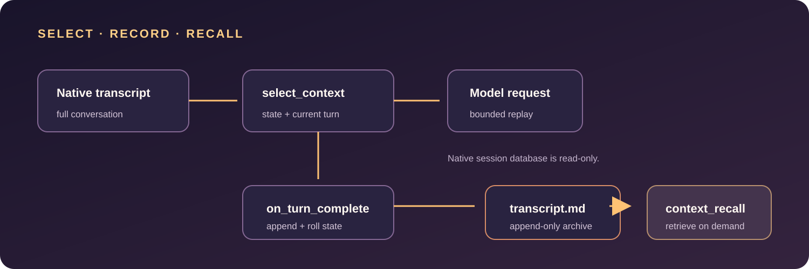

# How markdown-memory-hermes works

A Hermes Agent context-engine plugin. Hermes natively replays the full
conversation transcript on every LLM request, so input tokens grow with chat
length. This engine replaces everything before the current turn with a short,
frozen digest, keeps the current turn verbatim, and persists what it removed
to two files per session. No LLM summarisation anywhere — every step below is
deterministic text processing.

## The three seams

| Seam | When it runs | What it does |
|---|---|---|
| `select_context` | Before every API request | Swaps pre-turn history for `system prompt + digest + current turn` |
| `on_turn_complete` | When a turn finishes | Appends the turn to `transcript.md`, rolls `state.md`, freezes a new digest |
| `context_recall` (tool) | When the model asks | Searches `transcript.md` and returns matching turns |

## Request lifecycle

1. **Hermes assembles a request** — system prompt + full transcript replay +
   the new user message.
2. **`select_context` cuts it** — the cut point is always *before the current
   turn's user message*. The replacement is `[leading system messages] +
   [one user message carrying the digest] + [everything from the current
   turn's user message onward]`. The digest is injected as a `user` message,
   so the wire has two consecutive `user` messages; that is intentional and
   covered by tests.
3. **The digest is frozen mid-turn** — `on_turn_complete` is the only place
   the digest changes, so every retry and tool-round inside a turn replays a
   byte-identical prompt prefix (prompt-cache friendly). Verified by the
   benchmark harness: 19 of 20 turns in the measured scenario had exactly one
   digest hash across their 3 requests (turn 1 has no digest yet — its first
   request passes through unchanged).
4. **The turn finishes** — `on_turn_complete` extracts the turn
   deterministically (user ask, tool calls with ids and results, final
   response), appends it to `transcript.md`, and rewrites `state.md`.
5. **The model needs older detail** — it calls `context_recall` with a query;
   matching turn sections come back as tool results. You pay only for what
   you retrieve, and only when you retrieve it.

## The two files (per session, under `$HERMES_HOME/context-memory/<session>/`)

- **`state.md` — rolling working state.** Header (`Session`, `Updated`),
  `## Goal` (the first turn's user text, clipped to 300 chars — not a
  summary), then `## Recent turns`: up to **8 turns**, each `### Turn N
  (timestamp)` with `User:` (≤300 chars), `Tools used:` (≤10 names),
  `Assistant:` (≤500 chars). Hard cap **4,000 chars** — oldest turns drop
  first, but at least one turn is always kept. Written atomically
  (`.md.tmp` + `os.replace`). Measured: 907 chars after turn 1, 3,962 after
  turn 20 in the benchmark scenario (see `docs/BENCHMARKS.md`).
- **`transcript.md` — append-only archive.** One `## Turn N — timestamp —
  status: ok|failed|interrupted` section per turn, with `USER:` /
  `ASSISTANT:` / `TOOL_CALL <name> args:` / `TOOL_RESULT[<id> (<name>)]`
  lines, each clipped to 2,000 chars. **System messages are not archived**
  — the archive is a record of turns, not a complete transcript.

## Tool-call continuity guarantees

- The cut point is always before the current turn's user message, so every
  `tool_call_id` ↔ tool-result pair — including **parallel tool calls** and
  **multi-round turns** — stays inside the request. Provider pairing rules are
  never violated (asserted by tests on synthetic and real wire payloads).
- If the model needs pre-turn history, `context_recall` fetches it on demand
  instead of the request carrying it.
- `context_recall` takes `query` (required) and `limit` (default 5, clamped
  1–20). Sections are scored by substring matches per query term, best first.
  An empty query returns the last N turns. There is **no per-section or
  total-size cap** on what it returns — a broad query over a long archive can
  return a lot (known limitation, see below).

## Fail-open by design

- Every hook swallows its own exceptions: a broken session directory degrades
  recording to a no-op while selection keeps working.
- A session without memory files (or with an empty digest) **never** gets its
  history replaced — `select_context` passes the request through unchanged, so
  Hermes' native context behaviour applies. There is deliberately no
  placeholder digest: an earlier version substituted one after a session
  reset, discarding real history (fixed 2026-11-24, with regression tests).
- The host also wraps `select_context` in its own fail-open guard; a crashing
  engine cannot break a run. (Host-side property, not verifiable from this
  repo — no Hermes code lives here.)
- Compaction is disabled by design: `should_compress()` is always `False`
  and `compress()` returns messages unchanged. The engine owns the context
  policy; host compaction must never rewrite the persisted transcript.

## Migrating existing sessions

`bootstrap.py` reads the native session database (strictly read-only,
`mode=ro`) and creates memory files for existing sessions. Dry-run is the
default; `--write` creates files atomically and refuses to overwrite either
file. `--reconcile` / `--backfill` append turns that finished after a
snapshot (idempotent, append-only); `--repair-state` rebuilds `state.md`
from closed turns, backing the old file up first. Ambiguity (orphaned tool
results, missing user messages, first row not user) is flagged for manual
review instead of silently migrated. See the README for the commands.

## Limits — read these before relying on the engine

- **"Constant-size" describes the digest, not the request.** The digest is
  capped, but the current turn is sent verbatim and unbounded — a turn with
  huge tool results still makes a large request.
- **The first request of a session is never compressed** (no digest yet), and
  a session with no digest at all passes through natively.
- **Older detail is recoverable only if it was archived and `context_recall`
  finds it.** The archive drops system messages, and recall is substring
  scoring, not semantic search.
- **No locking.** Two processes writing the same session's files can
  interleave appends/replacements.
- **Session-id sanitisation can collide** (`sess/abc` and `sess_abc` map to
  the same directory; ids truncate at 120 chars). Two sessions sharing a
  directory would share/corrupt one `state.md`/`transcript.md`.
- **`on_session_reset` restarts turn numbering at 1** in the archive; the
  count is reconciled from the archive on the next `on_session_start`.
- **`bootstrap.py --reconcile` drops tool-call declarations** for assistant
  rows that carry only `tool_calls` and no text (backfill keeps them).
- **`repair-state` renumbers turns from 1**, which can disagree with the
  archive's existing numbering.

## Porting to other agent frameworks

The *pattern* — pre-send context replacement backed by markdown files — is
host-agnostic and model-agnostic. This implementation is Hermes-specific
because it binds to three Hermes facilities: the `ContextEngine.select_context()`
hook, the session database (for migration), and plugin discovery under
`~/.hermes/plugins/`. Porting means re-implementing the same contract against
the new host's interception point: replace accumulated messages with
`digest + current turn`, record completed turns on a turn-finalisation seam,
and expose a retrieval tool. Frameworks without a pre-send seam (most IDE
agents) cannot host this pattern without core changes.
